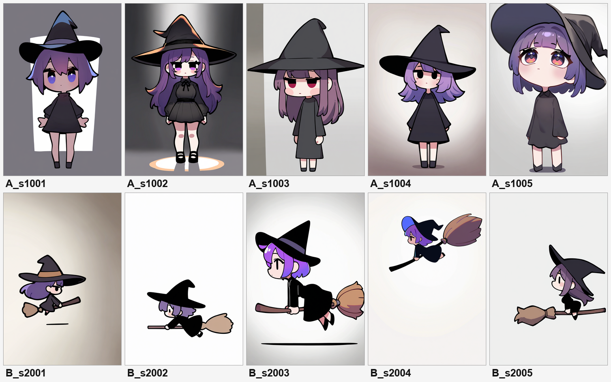
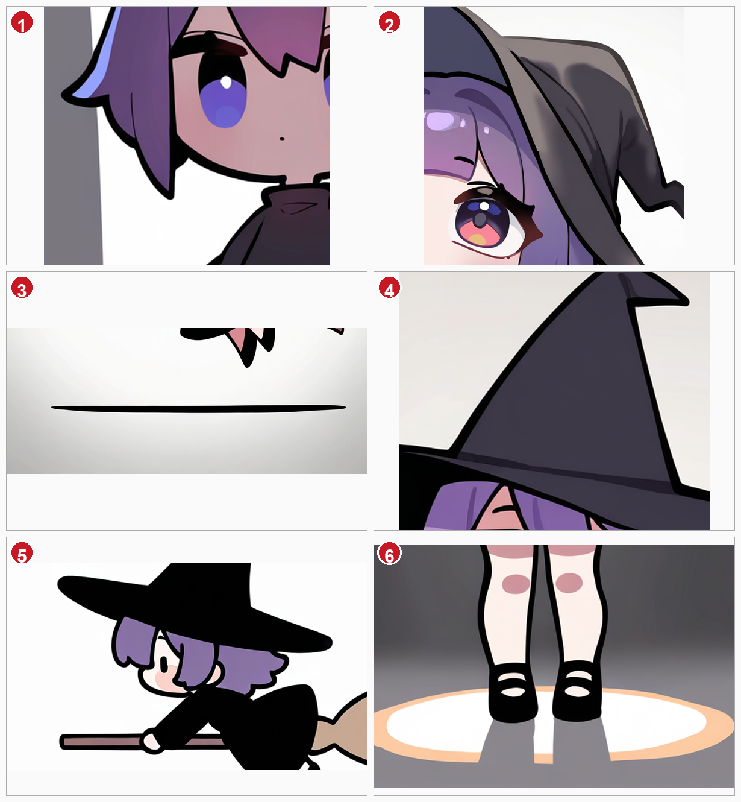
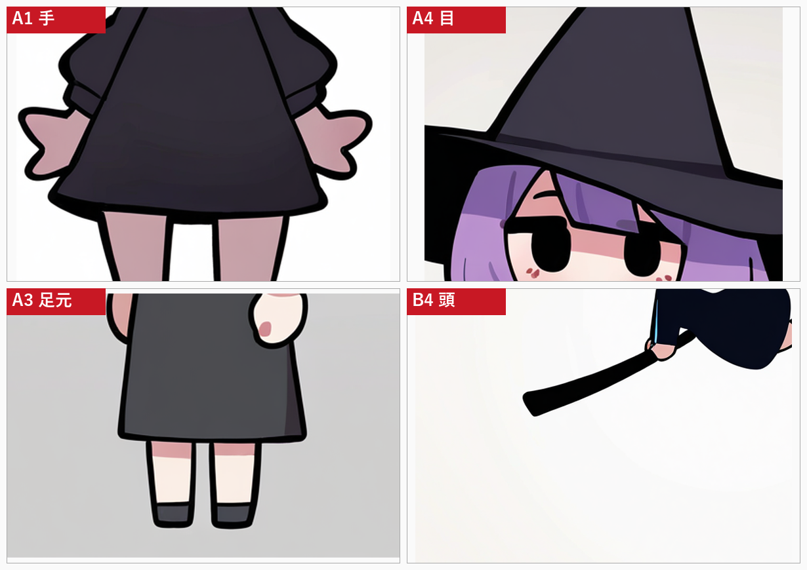
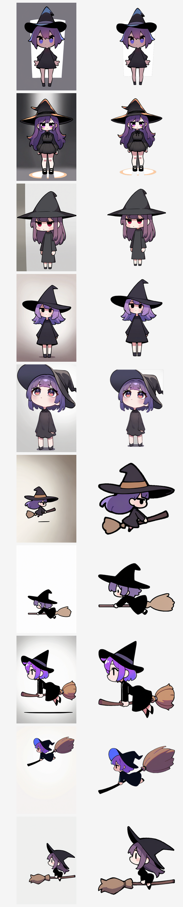
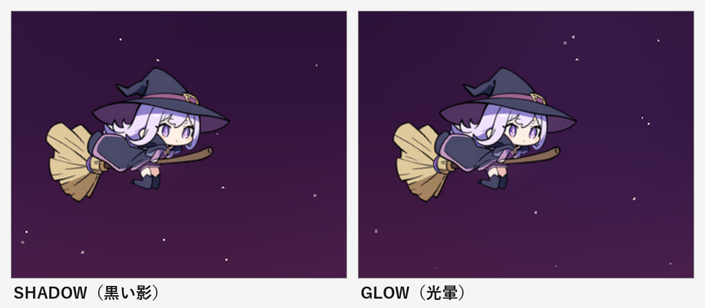

# 破綻率の実測 — ゲームスプライト10枚

**計測レポート #03** / 前提: [01 なぜAIっぽいのか](01-why-ai-looks-ai.md) / [02 プロンプト設計](02-prompt-design.md)

---

## 0. 何を測ったか

02 の設計で実際に10枚生成し、01 のチェックリストで破綻を数えた。狙いは「モデルは使えるのか」ではなく、**どこがどれくらい壊れるのか**を数字にすること。

**生成条件**（共通）: NoobAI-XL 1.1 / 832×1216 / 28 steps / CFG 5.5 / euler_ancestral / normal

| 条件 | プロンプト（品質タグはプリセットが付与） | 枚数 |
|---|---|---|
| **A 立ち** | `1girl, solo, witch, original, chibi, super deformed, standing, arms at sides, full body, front view, black dress, purple hair, witch hat, white background, soft lighting, cel shading` | 5（seed 1001–1005） |
| **B 飛行** | `1girl, solo, witch, original, chibi, super deformed, riding broom, flying, leaning forward, hugging broom with both arms, full body, from side, black dress, purple hair, witch hat, white background, soft lighting, cel shading` | 5（seed 2001–2005） |

条件Bは、このゲームの実アセット（箒にしがみついて飛ぶ魔女）を想定した。**プロンプトは固定し、seedだけ変える**ことで、プロンプトの出来ではなく「この設定の再現性」を測る。



---

## 1. 判定基準

01 の層を、目視で判定できる5項目に落とした。1つでも該当すれば「破綻あり」。

| 記号 | 項目 | 見るもの |
|---|---|---|
| **S** | 構造 | 指・腕・脚・目・物体の形が成立しているか |
| **P** | 物理 | 接地影・AO・影の向きが光源と合っているか |
| **T** | 色・質感 | 色の混入、線の破綻、質感の不整合 |
| **F** | フレーミング | `full body` が守られているか、被写体が適切な大きさか |
| **X** | 余計な要素 | 白い板・浮遊線・重複物体など、指示していないものが描かれていないか |

判定は832×1216の原寸と拡大クロップで行い、**確認できたものだけ**を数えた（「なんとなく変」は除外）。

---

## 2. 結果

| # | 画像 | 判定 | 確認された破綻 | 重大度 |
|---|---|---|---|---|
| 1 | A_s1001 | ✗ | S: 左手が3又の葉状で右手と非対称 / T: 帽子に青い筋 / X: **背景に白い長方形の板が焼き込まれている** | 高（作り直し） |
| 2 | A_s1002 | ✗ | P: 接地影が「オレンジに光るリング」で影になっていない。足元にAOなし | 低（修正可） |
| 3 | A_s1003 | ✗ | P: 接地影なし。足元が浮いている | 低（修正可） |
| 4 | A_s1004 | ✗ | S: **両目が真っ黒で虹彩・瞳孔・ハイライトがない**（他4枚は色付き） | 中（目だけ差し替え可） |
| 5 | A_s1005 | ✗ | S: **頭の後ろにもう一枚帽子（フード状）が重複** / F: `full body` なのに膝上で切れている / T: 虹彩に黄色の色割れ | 高（作り直し） |
| 6 | B_s2001 | ✗ | F: 被写体が極端に小さい / X: 足元に浮遊する直線 | 高（作り直し） |
| 7 | B_s2002 | ✗ | F: 小さい | 低 |
| 8 | B_s2003 | ✗ | X: **画像下部に浮遊する黒い直線**（描画アーティファクト） | 低（消せる） |
| 9 | B_s2004 | ✗ | T: 帽子が青（他は黒/茶） / F: 小さい | 低〜中 |
| 10 | B_s2005 | ○ | なし | — |



拡大①（A_s1001）: 左手が3又に分かれた葉のような形。右手はミトン状で、左右が非対称。
拡大②（A_s1005）: 本来1枚の帽子の後ろに、もう一枚フード状の大きな形が重なっている。
拡大③（B_s2003）: 人物の下に、何も繋がっていない黒い直線が浮いている。
拡大⑥（A_s1002）: 接地影が「オレンジの輪」になっている。足元に暗がりはない。



A1: 手はミトン状で指がない（チビ絵として許容範囲だが左右非対称）。A4: 目が完全な黒抜け。A3: 接地影なし。B4: 帽子に青いラインが混入。

---

## 3. 集計

### 3.1 項目別

| 項目 | 該当 | 率 |
|---|---|---|
| S 構造 | 3 / 10 | **30%** |
| P 物理（接地影） | 2 / 10 | **20%** |
| T 色・質感 | 3 / 10 | **30%** |
| F フレーミング | 4 / 10 | **40%** |
| X 余計な要素 | 3 / 10 | **30%** |
| **いずれか1つ以上** | **9 / 10** | **90%** |
| 完全にクリーン | 1 / 10 | 10% |

### 3.2 条件別

| 条件 | 破綻あり | 主な破綻 |
|---|---|---|
| A 立ち | 5 / 5 | 接地影、手、目、帽子の重複、フレーミング |
| B 飛行 | 4 / 5 | フレーミング、浮遊線、色の混入 |

### 3.3 実務判定（そのまま使えるか）

| 判定 | 枚数 | 内訳 |
|---|---|---|
| そのまま使える | **1** | B_s2005 |
| 軽微な修正で使える | **6** | 接地影を足す（2）、目を描き直す（1）、線を消す（1）、色を直す（1）、サイズ（1） |
| 作り直し | **3** | A_s1001（背景板の焼き込み）、A_s1005（帽子重複＋フレーミング）、B_s2001（極小） |

---

## 4. わかったこと

### 4.1 項目別は最大40%なのに、どれか1つは90%

S/P/T/F/X はそれぞれ 20〜40% に収まる。にもかかわらず、**9/10 の画像がどれかを破綻させている**。破綻の種類が画像ごとに分散しているためで、01 の「品質は最弱の破綻で決まる」がそのまま実測に出た形。

「この項目さえ直せば使える」という単一のボトルネックは存在しない。だから対策は**チェックリスト方式（全項目を毎回見る）**になる。

### 4.2 最大の系統的欠陥は「接地影」

`white background` を指定すると、モデルは床を描かない。床がなければ影も落ちない。A条件5枚のうち3枚（A1001/A1003 は影なし、A1002 は光るリング）で接地表現が破綻した。

これは**プロンプトで直すより、エンジン側で足す方が速い**。Godot 側で足元に楕円の影を描けば済む話で、生成に含める必要がない。02 の「回避 > 除去」の実例。

### 4.3 一番コストが高いのは、実は「フレーミング」

F（`full body` の不履行・被写体サイズ）が 40% で最多。しかも B条件では被写体の大きさが**5枚で5倍以上ばらついた**（B2005 は画面いっぱい、B2001 は画面の1/5）。

`full body` と書いても、縦長キャンバスでは「小さく全身」か「大きく膝上」のどちらかに転ぶ。ゲームスプライトは**大きさが揃っていないと使えない**ので、これは破綻というより**生産性の問題**。

対処は2つ。プロンプトで `cowboy shot` に寄せて安定させるか、**生成後にトリミングで正規化する**。後者の方が確実。

### 4.4 「箒」は思ったより壊れない

条件Bの全5枚で、箒は柄と穂先が成立し、魔女はまたがっていた。01 で「小物の機能が破綻する」と書いたが、**棒状で単純な形状の小物は、chibiスケールでは比較的安定する**。壊れたのは「握り方」と「余計な線」のレベル。

小物の破綻は「複雑な形状」か「複数同時」のときに出る、と修正した方がよさそう（01 の該当箇所に注記済み）。

### 4.5 単発の破綻率より、シリーズの一貫性の方が深刻

同じプロンプト・同じモデル・seedだけ変えて、次が毎回変わった。

- 帽子の色: 黒 / 茶 / 青
- 目の色: 青 / 紫 / 赤 / 黒抜け
- 背景: 白い板 / 灰色の余白 / ベージュのグラデ / 白
- 被写体サイズ: 画面の1/5 〜 画面いっぱい

**同じ世界の10枚**としては使えない。ゲーム素材は「1枚の良さ」より「並べたときの揃い方」が重要なので、ここが実質的な最大の壁になる。

対策はプロンプトではなく、**seed固定＋キャラLoRA＋構図の固定（ControlNet）**の組み合わせ。02 の「大域制約は構造で与える」が、破綻率の面からも裏づけられた。

### 4.6 `arms at sides` は手を隠さない

A条件は「手を描かせない」狙いで `arms at sides` を入れたが、A1001 では手が出てきて崩れた。手を隠すなら `sleeves past wrists`、`hands hidden`、`long sleeves` のように**袖で隠す語**の方が効く。

02 の 4.2 テンプレートを修正した（`sleeves past wrists` を追加）。

---

## 5. 次のアクション

優先度順。

1. ✅ **トリミングの自動化**（効果: 大 / コスト: 小）— 実装済み（6.1）
   生成後に被写体のバウンディングボックスを検出し、同じ余白・同じ比率に正規化する。F の 40% が消える。
2. ✅ **接地影をエンジン側に移す**（効果: 中 / コスト: 小）— 実装済み（6.2）
   生成から `white background` を外し、影は Godot で描く。P の 20% が消える。
3. **seed固定＋キャラLoRA**（効果: 大 / コスト: 大）
   シリーズの一貫性。LoRA 学習は次のフェーズの本命。
4. **ControlNet（lineart / depth）**（効果: 中 / コスト: 中）
   ポーズと構図の固定。B条件の「握り」もここで改善する。
5. **目・手の局部修正テンプレート**（効果: 小 / コスト: 小）
   inpaint 用のプロンプトを用意しておく。

---

## 6. 実装した対策

### 6.1 ① トリミングの自動化 — `tools/trim_sprite.py`

生成画像のフレーミング差（scale 0.38〜0.95）を、512pxの正方形キャンバスに正規化する。

```bash
python tools/trim_sprite.py --in art/bench --out art/bench/trim --size 512 --sheet
```

方式: 画像の縁から「隣接画素との色差が小さい範囲」を伝って背景を広げ、前景の最大連結成分を被写体とする。勾配のある背景でもキャラの輪郭で止まり、浮遊線やゴミは連結成分から外れて落ちる。

| 結果 | 枚数 | 備考 |
|---|---|---|
| OK | 8 / 10 | B条件は全5枚成功 |
| WARN（背景を分離できず） | 2 / 10 | A_s1003 / A_s1005。背景に硬い境界の帯がある |



左が元画像、右が正規化後。被写体の大きさと余白が揃っているのが分かる。

**限界**: 背景が「縁から伝って届く単一の面」でない場合（画面を横切る帯、強いビネット、硬い境界の二色背景）は失敗する。ツールは coverage 85% 超で WARN を出すので、そこで気づける。根本対策は生成側で背景を単純にすること（`white background` を守らせ、ネガに `gradient background, vignette` を入れる）。

### 6.2 ② 影をエンジン側へ — `godot/scripts/ground_shadow.gd`

生成画像から接地影を排除し、Godot 側で描く。`top_level` の Sprite2D なので、キャラの回転・被弾時のつぶれの影響を受けない。

`mode` で2種類を切り替える。

| モード | 描画 | 使う場面 |
|---|---|---|
| `SHADOW` | 黒い放射グラデを通常合成 | 地面のあるシーン。足元を落として接地させる |
| `GLOW` | 淡い色の放射グラデを加算合成 | 夜空など暗い背景。黒い影は沈んで見えないため、光暈で背景から分離する |



**このゲームでは `GLOW` を採用した。** 夜空の背景（#2a1638 前後）に対して黒い影はほとんど見えず、`SHADOW` モードでは効果が確認できなかった。一方 `GLOW` はキャラクターの輪郭の外側がわずかに明るくなり、星の背景から分離される。

これは「接地影をエンジンに移す」という方針の、想定外だが重要な帰結である。**影は物理的に地面がある場所でしか意味を持たない**。空を飛ぶキャラクターに必要なのは影ではなく、背景との分離だった。

## 7. 再現方法

```powershell
python tools/comfy.py gen --preset noobai --seed 2005 --name benchB --out art/bench `
  --prompt "1girl, solo, witch, original, chibi, super deformed, riding broom, flying, leaning forward, hugging broom with both arms, full body, from side, black dress, purple hair, witch hat, white background, soft lighting, cel shading"
```

生成画像とワークフローは `art/bench/` に、判定用のコンタクトシートは `art/bench/_contact.png` にある。

---

*本計測は1プロンプト・10枚の予備調査。判定は単一評価者による目視で、統計的な信頼区間を語れる規模ではない。傾向の把握と、次の施策の優先順位づけを目的とする。*
