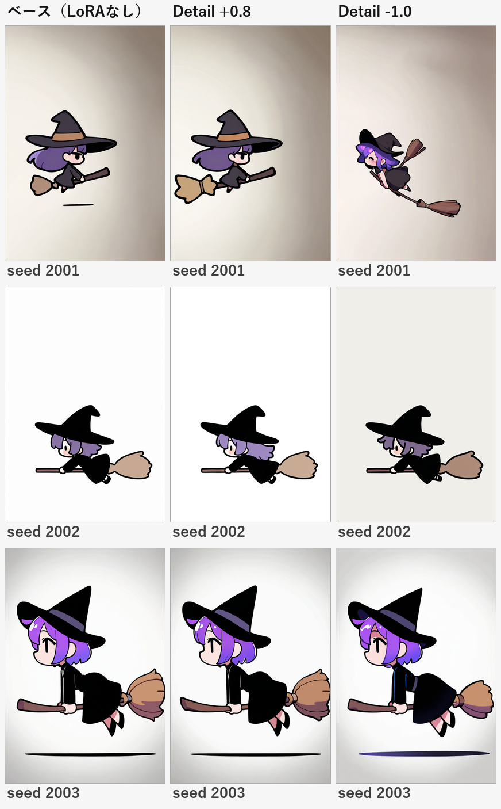
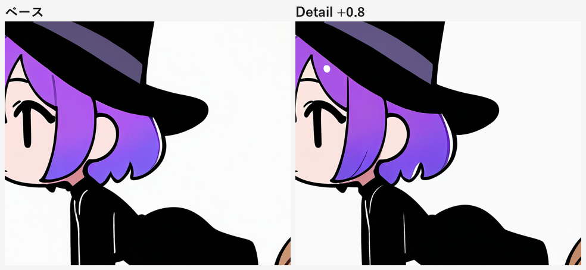

# LoRA の調査と導入

**調査メモ #04** / 前提: [03 破綻率の実測](03-breakage-benchmark.md) / [02 プロンプト設計](02-prompt-design.md)

---

## 0. 目的

「破綻を防げる LoRA」はあるのか。キャラクター LoRA（一貫性のため）はキャラ変更予定があるので保留し、ここでは**破綻そのものを減らす LoRA** だけを扱う。

---

## 1. 調査結果

Civitai API と Hugging Face を横断して候補を洗い出した。判断軸は「NoobAI / Illustrious と互換か」「認証なしで入手できるか」「商用利用の条件が読めるか」。

| 候補 | ベース | 想定効果 | 入手 | 判断 |
|---|---|---|---|---|
| **Detail Tweaker XL**（[Civitai 122359](https://civitai.com/models/122359)） | SDXL 1.0 | 質感・描き込みの増減（重み -3〜3） | **認証不要で取得可** | **導入** |
| Detail Tweaker Illustrious（[Civitai 1016670](https://civitai.com/models/1016670)） | Illustrious | 同上。Illustrious 専用 | ログイン必須 | 相性は良さそう。今回は見送り |
| Hand Fine Tuning（[Civitai 278497](https://civitai.com/models/278497)） | SDXL 1.0 | 手指の破綻低減 | ログイン必須 | 効果は未知数。要検証 |
| Hands And Body Repair（TensorArt 経由） | Illustrious | 手指・身体の修復 | ログイン必須 | 同上 |
| Hand Fixer XL（[Civitai 845407](https://civitai.com/models/845407)） | **Pony** | 手指の修復 | ログイン必須 | **不採用**。Pony の LoRA は NoobAI に効きにくい |

**構造的な問題**: 手指修復系は「Pony ベース」か「ログイン必須」のどちらかが多く、認証なしで試せるものがほぼない。また Illustrious 系で見つかるのはキャラクター LoRA ばかりで、修復ツール系は少ない。

---

## 2. 導入したもの

### 2.1 LoRA 本体

`add-detail-xl.safetensors`（218MB、Detail Tweaker XL）を `C:\AI\ComfyUI\models\loras\` に配置した。safetensors ヘッダを検証済み（2,958 テンソル、CLIP-L 側も含む）。

`ss_sd_model_name` のメタデータは `dreamshaperXL10_alpha2Xl10`。**SDXL 1.0 系の LoRA であり、NoobAI のネイティブ LoRA ではない**。この点は結果の解釈に効く。

### 2.2 `comfy.py` の LoRA 対応

`--lora NAME[:WEIGHT]` を追加した。複数指定すると直列につながる。

```bash
python tools/comfy.py loras                     # 導入済み一覧
python tools/comfy.py gen --preset noobai --lora "add-detail-xl.safetensors:0.8" --prompt "..."
```

ワークフロー上は `CheckpointLoader → LoraLoader（複数可） → CLIPTextEncode / KSampler` の順につながる。VAE はチェックポイント直結のまま。保存される `.json` に LoRA も記録されるので再現できる。

---

## 3. 実測

条件B（箒で飛ぶ魔女）の seed 2001–2003 で、LoRA なし / +0.8 / -1.0 を比較した。



### わかったこと

1. **構造破綻は減らない**
   2001 の浮遊線は +0.8 で消えたが、2003 の浮遊線は残った。seed 依存で、LoRA の効果ではない。

2. **-1.0（ディテール減）は破綻を悪化させることがある**
   2003 の浮遊線が、-1.0 では**紫のグラデーションの汚れ**に変わった。線が消えるのではなく、にじんだ。

3. **構図が変わる**
   同じ seed でも被写体の大きさ・ポーズが変わる。CLIP 側も書き換わるためで、`--lora` は「同じ絵に味付け」ではなく「別の絵」になる。seed 固定の再現性は LoRA 込みで管理する必要がある。

4. **フラットなアニメ調には効きが薄い**
   1:1 で比較すると、差はハイライトがわずかに増えた程度。



Detail Tweaker は写真・厚塗り系の質感を動かす LoRA で、**セル画的なフラット塗りにはほとんど作用しない**。L3（高周波の欠落）への対策として期待したが、この画風では効果が確認できなかった。

---

## 4. 結論

**LoRA は破綻対策の主役にならない。**

- 手指修復系は Pony ベースかログイン必須で、現状の構成では試せない
- 質感系はフラットなアニメ調に効きにくい
- 構造破綻（L1）は LoRA では動かない。**ControlNet と構図の単純化が担当**

一方で、LoRA の**仕組み自体は導入しておく価値がある**。キャラクターが固まったあとの一貫性 LoRA、画風の固定、NSFW 表現の調整など、用途は別にある。`--lora` はそのための土台として残す。

### 入手にはログインが必要なもの

次の2つは、Civitai / TensorArt のアカウントがあれば手動でダウンロードして `C:\AI\ComfyUI\models\loras\` に置くだけで使える（`comfy.py loras` に出る）。

- Hand Fine Tuning — [civitai.com/models/278497](https://civitai.com/models/278497)
- Detail Tweaker Illustrious — [civitai.com/models/1016670](https://civitai.com/models/1016670)

導入したら、同じ seed で「LoRA なし / あり」を並べて比較すれば効果が判定できる。手順は 03 の検証ループと同じ。

---

## 5. 注意（ライセンス）

Civitai API は、これらのモデルについて `allowCommercialUse` を返さなかった（未設定）。**商用可否が明示されていない**ため、ゲームを販売する場合は各モデルページのライセンスを個別に確認する必要がある。詳細 Tweaker XL はモデルページに記載があるので、使う前に読むこと。

---

## 6. 再現

```bash
python tools/comfy.py gen --preset noobai --seed 2003 `
  --lora "add-detail-xl.safetensors:0.8" `
  --prompt "1girl, solo, witch, original, chibi, super deformed, riding broom, flying, leaning forward, hugging broom with both arms, full body, from side, black dress, purple hair, witch hat, white background, soft lighting, cel shading" `
  --name lora_pos --out art/lora
```

生成物とワークフローは `art/lora/` にある。
