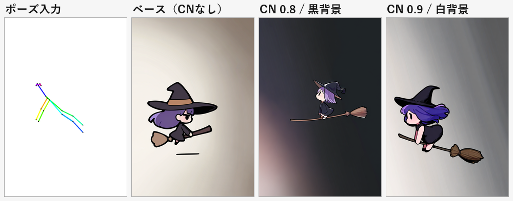

# ControlNet の導入

**実装メモ #05** / 前提: [03 破綻率の実測](03-breakage-benchmark.md) / [04 LoRA の調査](04-lora-survey.md)

---

## 0. 目的

LoRA では動かなかった **構造破綻（L1）とポーズの再現性** を、ControlNet で外から拘束する。01 で「大域制約は構造で与える」と書いた、その実装。

---

## 1. 導入したもの

### 1.1 ControlNet モデル（Apache-2.0）

| ファイル | 用途 | サイズ | ライセンス |
|---|---|---|---|
| `openpose-sdxl.safetensors` | ポーズ（棒人間）で拘束 | 2.33 GiB | Apache-2.0（商用可） |
| `canny-sdxl.safetensors` | 線画・輪郭で拘束 | 2.33 GiB | Apache-2.0（商用可） |

どちらも [xinsir](https://huggingface.co/xinsir) の SDXL 用 ControlNet。`models/controlnet/` に配置した。

**アニメ調モデルで使う注意**: SDXL ベースで学習された ControlNet なので、NoobAI / Illustrious にそのまま効くが、効果はベースモデルより弱まることがある。強度は 0.8〜0.9 から試すのがよい。

### 1.2 ポーズ入力 `tools/make_pose.py`

生成画像からポーズを抽出する代わりに、**座標から OpenPose（COCO-18）形式の棒人間を描く**。ポーズをコードで定義できるので、同じポーズをスプライト間で再利用できる。

```bash
python tools/make_pose.py --preset flying --size 832x1216 --bg white --out art/pose/flying.png
```

プリセットは `standing` / `flying` / `reaching`。`--spec pose.json` で任意のキーポイントを渡せる。`--bg` は `black`（OpenPose 標準）/ `white` / `gray`。

### 1.3 `comfy.py` の ControlNet 対応

```bash
python tools/comfy.py controlnets          # 導入済み一覧
python tools/comfy.py gen --preset noobai `
  --control-image art/pose/flying.png `
  --controlnet openpose-sdxl.safetensors `
  --control-strength 0.9 `
  --prompt "1girl, solo, witch, riding broom, flying ..."
```

ワークフローは `LoadImage → (Canny) → ControlNetApplyAdvanced → KSampler`。`--control-preprocess canny` を付けると、グレースケール画像から線画を作って canny 用に渡せる。

`--control-start` / `--control-end` で適用するステップ範囲を絞れる（既定は 0〜1）。

---

## 2. 実測

条件B（箒で飛ぶ魔女）の seed 2001 で比較した。



| 条件 | 結果 |
|---|---|
| **ベース（CNなし）** | 小さく描かれ、足元に浮遊線。ポーズは model 任せ |
| **CN 0.8 / 黒背景のポーズ画像** | 前傾ポーズにはなったが、**背景が暗く染まった**。被写体も小さいまま |
| **CN 0.9 / 白背景のポーズ画像** | 前傾して箒に乗る姿勢。被写体が大きく、**浮遊線も消えた** |

### わかったこと

**1. ポーズは確かに効く。** ベースでは「座った姿勢」だったのが、骨格を渡すと「前傾してしがみつく姿勢」に変わる。手を前に出す位置も骨格に沿う。

**2. ポーズ画像の背景色が生成に漏れる。** 黒背景の OpenPose 画像を渡すと、出力の背景まで暗くなる。白背景にすると軽減した。**OpenPose の標準は黒だが、この構成では白が良い。**

**3. 位置とスケールは保持されない。** 骨格は画面中央の小さな領域に描いたのに、出力では被写体がフレームいっぱいに拡大される。ControlNet が見ているのは関節の相対配置で、絶対座標ではない。**大きさの統一は 03 のトリミングで行う**（役割分担）。

**4. 強度 0.8 では別のポーズに落ちることがある。** 同じ骨格でも seed によって「前傾」と「直立」に分かれた。0.9 まで上げると安定したが、上げすぎると絵が硬くなる。

**5. 副産物として破綻が減る。** seed 2001 の浮遊線（03 で L1 破綻として数えたもの）が、CN 0.9 では消えた。構図が拘束されると、モデルが余計なものを描く余地が減るらしい。

---

## 3. canny（線画）の使い方

まだ本格検証はしていないが、`--control-preprocess canny` で線画を抽出して渡せる。ラフ画を描いて構図を固定したい場合に使う。

```bash
python tools/comfy.py gen --control-image art/pose/rough.png `
  --controlnet canny-sdxl.safetensors --control-preprocess canny `
  --control-strength 0.7 `
  --prompt "..."
```

線画は輪郭が強い制約になるため、強度は 0.6〜0.75 から始めるのが無難（高すぎると塗りが破綻する）。

---

## 4. 現在のパイプライン

```
生成（プリセット）
  ├─ ControlNet: ポーズ / 線画で構造を拘束
  └─ LoRA: 質感・画風（任意）
↓
トリミング（被写体サイズを正規化）
↓
Godot: 影 / 光暈をエンジン側で描画
```

**役割分担がはっきりした**のがこの実装の成果。ControlNet は「形」、トリミングは「大きさ」、影は「接地・分離」を担当し、互いに干渉しない。

---

## 5. 再現

```bash
python tools/make_pose.py --preset flying --size 832x1216 --bg white --out art/pose/flying.png
python tools/comfy.py gen --preset noobai --seed 2001 `
  --control-image art/pose/flying.png `
  --controlnet openpose-sdxl.safetensors --control-strength 0.9 `
  --prompt "1girl, solo, witch, original, chibi, super deformed, riding broom, flying, leaning forward, hugging broom with both arms, full body, from side, black dress, purple hair, witch hat, white background, soft lighting, cel shading" `
  --name cn_white --out art/cn
```

生成物とワークフローは `art/cn/` と `art/pose/` にある。
