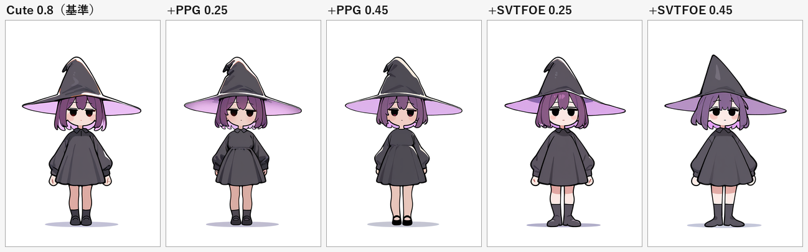

# 絵柄の方向づけ — 要素抽出とスタイル LoRA

> **【撤回】** 特定作品の画風 LoRA を使う方針は取り下げた。IP 固有の画風は使用せず、要素のみを汎用 LoRA とプロンプトで再構成する。現在の内容は [07 要素ベースの絵柄設計](07-style-generic.md) を参照。

**調査メモ #06** / 前提: [02 プロンプト設計](02-prompt-design.md) / [04 LoRA の調査](04-lora-survey.md)

---

## 0. 狙い

「ご注文はうさぎですか？」「まちカドまぞく」「きんいろモザイク」の**可愛い絵柄**に、「パワーパフガールズ」「悪魔バスター★スターバタフライ」の**カートゥーン調**を合わせる。まず要素に分解し、それに近い LoRA を選んで実際に重ねるところまで確認する。

---

## 1. 要素の抽出

| 作品 | 線 | 彩色 | 陰影 | 頭身・形 | 目 | モチーフ |
|---|---|---|---|---|---|---|
| ご注文はうさぎですか？ | 細く均一 | パステル・低彩度 | セル＋柔らかいぼかし | 約3.5頭身、丸い輪郭 | 大きく多層ハイライト | カフェ・うさぎ |
| まちカドまぞく | 細線＋デフォルメ | 淡い色 | セル | 約3頭身 | 大きな丸目 | 魔法少女・ギャグ |
| きんいろモザイク | 細く均一 | 明るいパステル | セル | 約4頭身 | 丸い目 | 金髪・英国 |
| パワーパフガールズ | **極太・均一** | **原色フラット** | **影1段** | 約2頭身、記号的な形 | 単純な巨大な丸 | スーパーヒーロー |
| スター・バタフライ | **太線** | ポップな高彩度 | フラット＋簡易影 | 約3頭身 | 丸目・表情豊か | 星・魔法 |

**共通項**: 丸い形、大きな目、低頭身、明るい色調。

**対立項**: 線の太さ（細 ↔ 極太）、陰影（セル＋ぼかし ↔ 完全フラット）、彩度（パステル ↔ 原色）。

### 合成の方針

対立する軸を「どちらかに寄せる」のではなく、**役割を分ける**。

| 要素 | 採用する側 | 理由 |
|---|---|---|
| 顔・体型・髪 | きらら系（丸・大目・低頭身） | 「可愛い」の主成分。ここを崩すと狙いが消える |
| 線・塗り | カートゥーン（太線・フラット・影1段） | 「カートゥーン調」の主成分。線の太さが最も効く |
| 彩度 | 中間（パステル基調＋差し色に原色） | 原色に振ると「可愛い」が壊れる |

---

## 2. 導入した LoRA

すべて Illustrious ベース（NoobAI と同系統）で、**Civitai ログイン不要**で取得できたもの。

| ファイル | 元モデル | サイズ | 役割 |
|---|---|---|---|
| `cute-anime.safetensors` | [Cute anime style (1300687)](https://civitai.com/models/1300687) | 218MB | 顔・体型（きらら系の代替） |
| `soft-anime.safetensors` | [Soft anime style (2029197)](https://civitai.com/models/2029197) | 218MB | 柔らかい塗り（比較用） |
| `ppg-style.safetensors` | [Powerpuff Girls Style (1127590)](https://civitai.com/models/1127590) | 244MB | 太線・フラット塗り |
| `svtfoe-style.safetensors` | [Star Vs The Forces Of Evil Style (1661948)](https://civitai.com/models/1661948) | 244MB | 太線・ポップな色 |

---

## 3. ログインが必要なもの

**本命の1本がログイン必須**だった。

| モデル | ベース | リンク | 理由 |
|---|---|---|---|
| **Gochuumon wa Usagi desu ka Anime Style** (2439370) | Illustrious | [civitai.com/models/2439370](https://civitai.com/models/2439370) | 画風 LoRA。これが「きらら系」の直球 |
| Cute Simplified Anime Style - Illustrious (2001119) | Illustrious | [civitai.com/models/2001119](https://civitai.com/models/2001119) | 簡略化＋可愛い。カートゥーン寄りの中間になる可能性 |

補足: **「まちカドまぞく」「きんいろモザイク」の画風 LoRA は存在しない**（キャラクター LoRA のみ）。3作品は同じ「きらら系」の文法なので、GochiUsa の画風 LoRA で代表させるのが現実的。

---

## 4. 実測

同じ seed・同じプロンプトで、重みだけ変えて比較した。



| 構成 | 結果 |
|---|---|
| Cute 0.8（基準） | パステルで柔らかい。線は細め |
| **Cute 0.8 + PPG 0.25** | 線が太くなり、影が1段に整理される。顔は可愛いまま |
| Cute 0.8 + PPG 0.45 | 線が最も太い。フラット寄りだが、やや硬い |
| Cute 0.8 + SVTFOE 0.25 | 線が太く、形が少し丸くなる。色は穏やか |
| Cute 0.8 + SVTFOE 0.45 | 太線＋フラット。表情はやや単純になる |

### わかったこと

**1. 効くのは主に「線の太さ」と「影の段数」。** 顔の記号（大きな目・低頭身）は、LoRA よりもプロンプトの `chibi, super deformed` に引っ張られる。つまり**狙いの8割はプロンプトで決まっていて、LoRA は線と塗りの調整役**。

**2. 0.25 と 0.45 で差が出るのは線の太さ。** 目を残したいなら 0.25 前後が上限。0.45 まで上げるとカートゥーン寄りになるが、きらら系の「目で語る」感じは弱くなる。

**3. 推奨は Cute 0.8 + PPG 0.25。** 顔を維持しつつ、カートゥーンの線が出る。SVTFOE 0.25 も同等だが、色がやや落ち着く。

**4. 2本までが実用域。** 3本以上重ねると線と塗りが喧嘩して、輪郭がにじむ。

---

## 5. 注意

- **特定作品の画風 LoRA は著作権的にグレー**。個人利用なら問題になりにくいが、ゲームを配布・販売する場合は権利者の許諾が必要になる可能性が高い。商用なら「きらら系」に似たオリジナル画家の LoRA か、自作 LoRA に切り替えるべき。
- LoRA の重みの合計は **1.2 以下**が目安。超えると構図が崩れやすい。
- スタイル LoRA は seed ごとの振れ幅が大きい。10枚出して中央値で判断すること。

---

## 6. 使い方

```bash
python tools/comfy.py gen --preset noobai --seed 4001 `
  --lora "cute-anime.safetensors:0.8" --lora "ppg-style.safetensors:0.25" `
  --prompt "1girl, solo, witch, original, chibi, super deformed, standing, full body, black dress, purple hair, witch hat, white background, soft lighting" `
  --name style_test --out art/style
```

---

## 7. 次の一手

GochiUsa の画風 LoRA（2439370）をログイン後に `C:\AI\ComfyUI\models\loras\` へ置けば、同じ比較をもう一度回せる。おそらく `cute-anime` より「きらら感」が強く出るので、**GochiUsa 0.7 + PPG 0.25** が本命の配合になる。

入手したら声をかけてほしい。比較と重みの詰めをやる。
