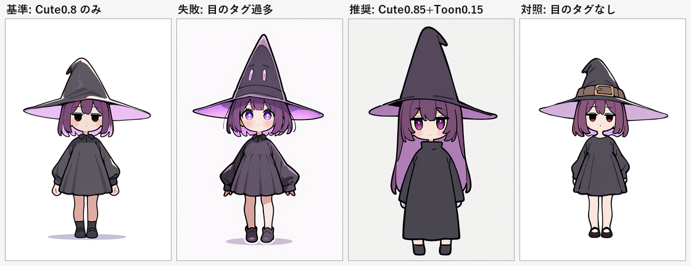

# 要素ベースの絵柄設計（IP画風LoRAなし）

**調査メモ #07** / 前提: [06 絵柄の方向づけ](06-style-direction.md)（方針変更により一部撤回）

---

## 0. 方針

06 では特定作品の画風 LoRA を候補にしたが、**IP 固有の画風を再現する LoRA は使用しない**方針に変更した。ここでは「可愛い」「カートゥーン」を**要素に分解し、汎用 LoRA とプロンプトで再構成する**。

参考作品は要素の抽出元としてのみ扱う（画風の複製はしない）。

---

## 1. 要素の再定義

参考作品から抽出した要素を、作品名から切り離して定義し直す。

| 軸 | 目標 | 具体 |
|---|---|---|
| **形** | 丸く、低頭身 | 2.5〜3頭身、丸い輪郭、手足は短く単純 |
| **顔** | 目で語る | 大きな虹彩、多層ハイライト、頬の赤み、小さな口 |
| **線** | 太く均一 | 一定の太さの輪郭線、線の途切れがない |
| **塗り** | フラット | セル塗り、影は1〜2段、グラデーションは最小 |
| **色** | 明るくパステル | 低〜中彩度、差し色に原色を1色 |
| **記号性** | 単純化 | 細部より形の読みやすさを優先 |

前回の分析で「対立する軸」と書いた線の太さ・陰影・彩度は、**カートゥーン側に寄せる**。顔と体型は**可愛い側**に寄せる。これが「可愛い × カートゥーン」の配合になる。

---

## 2. 採用した LoRA

選定基準は4つ。**汎用（特定IP・特定作家の画風でない）／生成物の商用可／Illustrious 互換／認証なしで取得可**。

| ファイル | 元モデル | 商用 | 役割 |
|---|---|---|---|
| `cute-anime.safetensors` | [Cute anime style (1300687)](https://civitai.com/models/1300687) | Image, Rent, RentCivit | 顔・体型（可愛い側） |
| `toon-style.safetensors` | [toon style 1 (2529486)](https://civitai.com/models/2529486) | **Sell**, Image, Rent, RentCivit, SellMerge | 太線・フラット（カートゥーン側） |
| `chibi-style.safetensors` | [Chibi Style - Style_mix (182276)](https://civitai.com/models/182276) | Image, Rent, RentCivit | 頭身（補助） |
| `soft-anime.safetensors` | [Soft anime style (2029197)](https://civitai.com/models/2029197) | **Sell**, Image, Rent, RentCivit, SellMerge | 柔らかい塗り（比較用） |
| `add-detail-xl.safetensors` | Detail Tweaker XL (122359) | 未設定 | 質感（今回は未使用） |

`Sell` は「モデル自体の販売」まで許可する広い条件。画像生成に使う分には `Image` があれば足的りている。

### 除外したもの

`C:\AI\ComfyUI\models\loras\_disabled\` に隔離した。`comfy.py loras` には出ない。

| ファイル | 理由 |
|---|---|
| `ppg-style.safetensors` | 特定作品の画風 |
| `svtfoe-style.safetensors` | 特定作品の画風 |
| `cartoony-flat.safetensors` | 特定作家の画風（汎用ではない） |

---

## 3. 配合の実測



| 構成 | 結果 |
|---|---|
| 基準: Cute 0.8 のみ | 可愛いが線は細く、カートゥーン味はない |
| 失敗: 目のタグ過多 | **帽子にも目が描かれた**（`big eyes, purple eyes, detailed eyes` を強くしたため） |
| **推奨: Cute 0.85 + Toon 0.15** | 大きな紫の目を保ちつつ、輪郭が太くフラットになる |
| 対照: 目のタグなし | 破綻はないが、目が小さく「可愛い」が弱い |

### わかったこと

**1. 目のタグは帽子に増殖する。** `big eyes, purple eyes, detailed eyes` を並べると、大きな帽子の面を顔と誤認して目を描く。対策は `witch hat on head` を**目のタグより前**に置き、`detailed eyes` を外すこと。位置の修飾が効く。

**2. Toon は 0.15 が上限。** 0.3 まで上げると線は太くなるが、目の描写が潰れて「可愛い」が消える。0.15 で「線だけ借りる」のが正解。

**3. 可愛さの8割はプロンプト。** `chibi, super deformed, big purple eyes` と `thick outlines, flat color` の組み合わせで、狙いの大半は出る。LoRA は線の質感を整える補助。

**4. 汎用 LoRA では「きらら感」に上限がある。** IP 画風 LoRA を使わない以上、特有の目の描き方や髪の処理までは届かない。**オリジナルの画家性として寄せる**のが現実的な落としどころ。

---

## 4. 推奨レシピ

```bash
python tools/comfy.py gen --preset noobai --seed 4001 `
  --lora "cute-anime.safetensors:0.85" `
  --lora "toon-style.safetensors:0.15" `
  --prompt "1girl, solo, witch, original, chibi, super deformed, standing, arms at sides, full body, front view, witch hat on head, purple hair, big purple eyes, long sleeves, black dress, white background, soft lighting, thick outlines, flat color" `
  --name style_test --out art/style2
```

**プロンプトの順序が効く**。`witch hat on head` → `purple hair` → `big purple eyes` の順を守る。目のタグを先頭に置くと帽子に目が生える。

---

## 5. 残っている課題

- **帽子が大きくなりすぎる**。`large hat` を外し、`small witch hat` にするか、帽子を後工程で描き直す
- **服が簡略化されすぎる**。`frilled dress, ribbon` などの装飾タグを足すか、`toon` の重みを 0.1 に下げる
- **頭身が上がる**（4頭身寄りになる）。`chibi` の重みを上げるか、`chibi-style` を 0.2 併用

これらは「カートゥーンに寄せるほど装飾が削られる」というトレードオフの現れ。**ゲームスプライトとしてはシンプルな方が扱いやすい**ので、どこで止めるかは用途次第。

---

## 6. ライセンスの扱い

- `allowCommercialUse` に `Image` が含まれることを確認済み（上表）
- ただし Civitai の設定は出品者が後から変更できる。**納品・販売の直前に再確認**すること
- IP 画風 LoRA は使わない。特定作家の画風 LoRA も同様に避ける
- 生成物の著作権は国・法域で扱いが異なる。商用利用時は別途確認が必要
