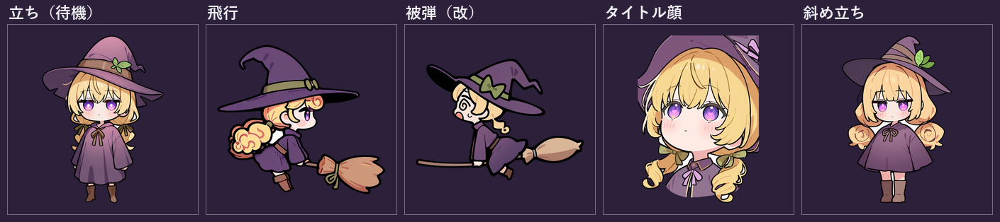
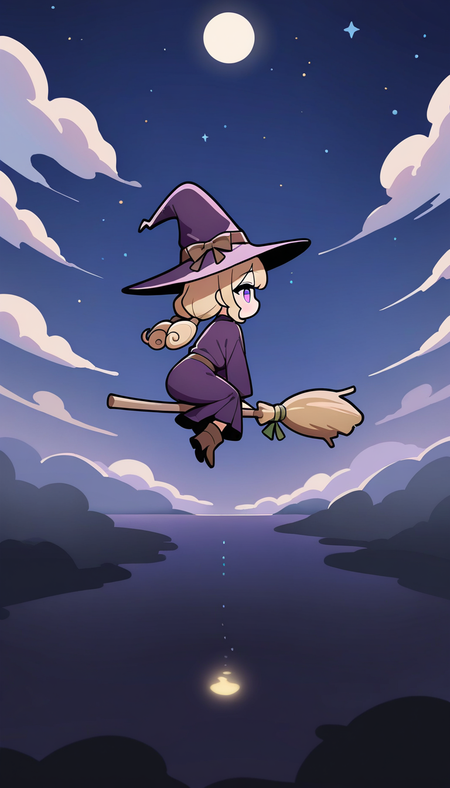
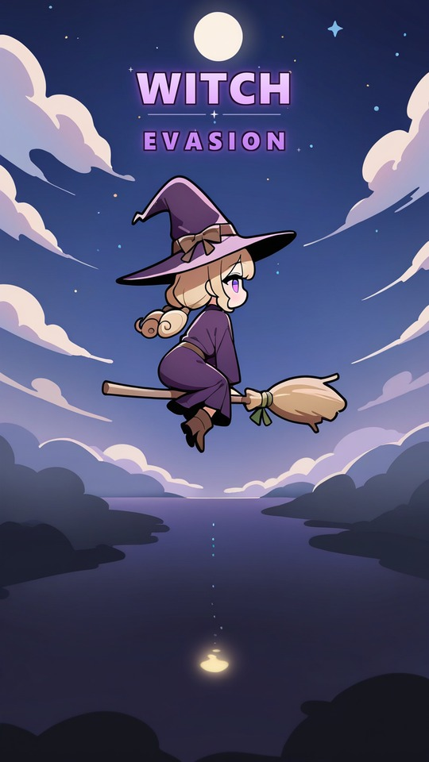
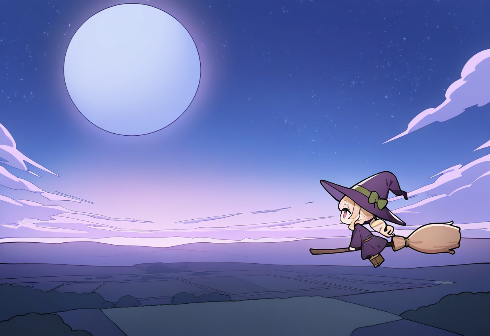

# 見習い魔女メルル 設定と導入

## コンセプト

高いところが苦手な見習い魔女が、暴走したほうきに乗ったまま神々の住む「神域」まで強制上昇してしまう、ほのぼのコミカルな縦スクロールアクション。

| 項目 | 決定内容 |
| --- | --- |
| 雰囲気 | ほのぼの・コミカル |
| 主人公 | 10代前半の見習い魔女、臆病だけど優しい |
| 飛ぶ理由 | 魔法の失敗でほうきが止まらない |
| 方向 | 上へ昇る |
| 障害物 | 上へ行くほど派手になる |
| 相棒 | なし（独り言で見せる） |
| 魔法 | まだ何も使えない |
| ゴール | 神域（天使や神がいる） |
| 導入形式 | ゲーム内のセリフ付きシーン |

## 主人公：メルル・ポプリエ

麓の小さな村に住む、12歳の見習い魔女。魔女なのに高所恐怖症で、ほうきは地面から膝の高さまでしか浮かべられない。

| 項目 | 設定 |
| --- | --- |
| 名前 | メルル・ポプリエ（別案：ニナ・ブルームベル／ティコ・マシュマリー） |
| 年齢 | 12歳 |
| 立場 | 大魔女グランマ・ポプリエ（祖母）のもとで修行中。修行の大半は家事と掃除 |
| 性格 | 臆病で怪しい物音にも飛び上がる。その分人や生き物の痛みに敏感で、誰かが困っていると震えながらでも放っておけない |
| 口癖 | 「ひゃっ！」「ご、ごめんなさい〜！」（障害物にも謝る） |
| 苦手 | 高いところ、大きい音、目立つこと |
| 好き | 掃除、あたたかいミルク、地面 |
| 魔法 | まだ何も使えない。唯一使えるのは「ほうきにまたがること」 |

**見た目（改訂）**

> 旧スプライトは紫髪だったが、設定は「たんぽぽ色のくせ毛」。ここを設定側に合わせる。
> 紫ローブ＋紫髪はコントラストが低く、小さいスプライトで潰れるため、配色としても黄髪が正しい。

- **シルエット**: 大きな三角帽子＋丸いマント＋短い脚の「三角形」。32px でも判別できる形を優先する
- **帽子**: 濃紫。つばは広いが、**目の位置より上で止める**（顔を隠さない）。付け根にミントのリボン
- **髪**: たんぽぽ色のくせ毛を低い二つ結び。毛先は外へ跳ねる。前髪は目の上で止める
- **ローブ**: 薄紫。袖が余って**手が隠れる**（手の破綻を隠す狙いも兼ねる）
- **胸元**: ミント色のリボン。ここだけ差し色
- **靴**: 濃茶のショートブーツ
- **目**: 紫。大きめで、ハイライトは2点。頬に赤み
- 飛行中はほうきにしがみついて目をつぶりがち（「しがみつきポーズ」を基本に）

**カラーパレット**

| 用途 | 基本色 | 影色 |
| --- | --- | --- |
| 髪 | `#F2C14E` | `#D99A2B` |
| ローブ | `#8E7CC3` | `#6B5A9E` |
| 帽子 | `#3B2A4A` | `#5A4470`（つば裏） |
| リボン | `#7FD8BE` | `#4FB79B` |
| 肌 | `#FBE3D6` | `#F2C4B4` |
| 頬 | `#F4A7B9` | — |
| 靴 | `#5B4033` | `#3E2B22` |
| 線 | `#2B2030` | — |

**制作上の制約**

スプライトは 240×190 前後で使うため、細部は描かない。以下を守る。

1. **3頭身**。頭・胴・脚で3つ
2. **手は袖で隠す**。指を描かせない（破綻の最大要因を構造的に回避）
3. **装飾は3つまで**（帽子リボン・胸リボン・ブーツ）。増やすと小サイズで潰れる
4. **線は太く均一**、影は2段まで
5. 帽子のつばで顔を隠さない（表情が読めなくなる）

**表情とポーズ（ゲームで使う分）**

| 用途 | 表情 | ポーズ |
| --- | --- | --- |
| 待機 | 困り顔（眉を下げる） | 立ち、腕は下ろす |
| 飛行（メイン） | 目をつぶる／必死 | ほうきにしがみつく、前傾 |
| 被弾 | 目を見開く、口を開ける | のけぞる、腕を上げる |
| タイトル | 泣きそう | 見上げる、帽子を押さえる |

**よける理由の味付け**：勇気ではなく「怖いから必死で逃げる」。よけるたびに障害物へ謝るボイスを入れると、プレイ中もキャラが立ちます。

## 暴走の原因と神域

ほうきは「世界でいちばん高い場所」に着くまで止まらず、その場所が神域です。障害物が派手になるのは、暇を持て余した神々が面白がって演出を盛り上げているせいです。

**暴走の原因**

- メルルは空を飛べない自分を変えたくて、グランマの棚から「ちょっとだけ高く飛べる薬」をこっそり拝借する
- 実際には大魔女用の秘薬「天のぼりの香油」。しかも慣れない手つきでびんごとこぼしてしまう
- 香油の効果は「この世でいちばん高い場所に着くまで上昇し続ける」。下りることも、飛び降りることもできない

**神域**

- 雲と星のさらに上にある、天使と神々の住まい。人間がたどり着いた例は数百年ない
- 神々は永遠の平和に退屈しており、下界から泣きながら昇ってくる小さな魔女を「久しぶりの見物」として観戦する
- 「もう少し派手にしてみよう」という悪気のない悪乗りで、上へ行くほど障害物が大きく、種類も続々と増えていく
- この設定により、「なぜ上へ行くほど派手になるのか」を世界観の中で説明できる

## ステージ構成案

暮らしの空から神話の空へ、5段階で障害物が派手になります。下のステージほど「日常の小物」、上ほど「神々の演出」が混じります。

| ステージ | 風景 | 主な障害物 | 神々の様子 |
| --- | --- | --- | --- |
| 1 村の空 | 屋根と煙突、朝焼け | 飛んできた洗濯物、風見鶏、鳩の群れ | まだ気づいていない |
| 2 丘と森の上空 | 緑の丘、風車 | たんぽぽの綿毛の嵐、風船、渡り鳥 | 「おや、何か昇ってくる」 |
| 3 雲の層 | 雲海と虹 | 雷雲、大粒の雨、空クジラの潮吹き | こっそり雷を足し始める |
| 4 星の海 | 夜空と天の川 | 流れ星、彗星、巨大なシャボン玉の惑星 | 客席ができて大盛り上がり |
| 5 神域の門 | 黄金の雲と光の柱 | 天使のラッパの衝撃波、降り注ぐ光の柱、紙吹雪 | 神々自ら「最後の試し」をしかける |

ステージの合間に、メルルの短い独り言と神々の実況コメントを挟むと、相棒なしでも会話のテンポが保てます。

## 導入シーン台本

約2分、6カットで「臆病なメルル→薬をこぼす→強制上昇→プレイ開始」までを見せます。（　）内はト書きです。

### カット1：魔女の家・裏庭（朝）

（小鳥の声。メルルがほうきにまたがり、地面から数センチだけ浮いている）

メルル「う、浮いてる……ちゃんと浮いてるよね……？」

（足元のアリが下をくぐって通り過ぎる）

メルル「……アリさんに追い越された。」

### カット2：部屋

（机の上にグランマの置き手紙）

手紙『メルルへ。薄荷を摘みに出かけます。留守中、棚の上の小びんには絶対にさわらないこと。　グランマより』

メルル「棚の上……。」

（棚を見上げる。『天のぼり』と書かれた小びんがきらりと光る）

メルル「天……のぼり？　これ、もしかして……高く飛べるお薬……？」

メルル「だ、だめだめ！　さわっちゃだめって書いてあるもん！」

（間。窓の外で、同い年くらいの魔女たちが楽しそうに空を飛んでいく）

メルル「……ちょっとだけ。ほんの、ちょっとだけなら……。」

### カット3：事故

（踏み台に乗って手を伸ばすメルル。小びんに指が触れた瞬間、屋根裏からネズミが飛び出す）

メルル「ひゃっ！！」

（小びんが宙を舞い、壁に立てかけたほうきに中身がまるごとかかる。ほうきが金色に光り、ブルブルと震え出す）

メルル「ご、ごめんなさい〜！　いま拭くから……って、え、え？」

### カット4：打ち上げ

（ほうきが勝手にメルルの足の間に滑り込む）

メルル「待って待って待って――！！」

（天井の天窓を突き破って、真上へ打ち上がる。屋根瓦が一枚、コトンと落ちる）

### カット5：村の上空

（どんどん小さくなる村。メルルはほうきにしがみつき、帽子で目を隠している）

メルル「下りて……おねがい、下りてえ……！」

（小びんのラベル裏が風でめくれ、小さな文字が見える）

ラベル『効能：この世でいちばん高い場所に着くまで、止まりません。』

メルル「……いちばん……高い……？」

メルル「うそでしょおおおおお！！」

### カット6：はるか上空・神域

（雲の上の黄金の庭。ヒマそうに寝転んでいた神々が、下界をのぞき込む）

神々「おや、何か昇ってくるぞ。」

神々「人間の子じゃ。泣きながらじゃ。」

神々「……面白い。少し、試してみるか。」

（画面が縦スクロールのゲーム画面へ切り替わる。『STAGE 1　村の空』）

メルル「ひゃっ……洗濯物が、飛んでくる〜！！」

## 次に決めたいこと

- [ ] 名前の確定（メルル・ポプリエで良いか）
- [ ] 神域に着いた後の結末（例：神々に「全部よけた人間は初めて」と褒められ、帰り道に初めての魔法を授かる）
- [ ] 神々の人数と個性（実況役・解説役を立てるか）
- [ ] ゲームオーバー時の扱い（ぶつかっても上昇は止まらない設定との整合）
- [ ] グランマの再登場の有無

## イラスト制作レシピ

[07 要素ベースの絵柄設計](ai-quality/07-style-generic.md) の方針に従う。IP画風LoRAは使わない。

```powershell
python tools/comfy.py gen --preset noobai --seed 5041 `
  --lora "cute-anime.safetensors:0.85" `
  --prompt "1girl, solo, witch, original, chibi, super deformed, standing, arms at sides, full body, front view, witch hat on head, blonde curly hair, low twintails, big purple eyes, long sleeves, purple robe, brown boots, mint ribbon, white background, soft lighting, cel shading, detailed hair, gradient shading" `
  --name meluru_stand --out art/meluru/rich2
```

**タグの順序**: `witch hat on head` → 髪 → 目。目を先に置くと帽子に目が生える。

**Toon LoRA は使わない**。使うと陰影が削られて平坦になる（使うなら 0.05〜0.1 の味付け）。

| 用途 | 追加・変更するタグ |
| --- | --- |
| 飛行 | `riding broom, flying, leaning forward, holding broom, from side` ＋ ControlNet（pose 0.9） |
| 被弾 | `spiral eyes, mouth wide open, sweat, impact lines` ＋ ControlNet（pose 0.9）※`hit`/`falling` は使わない |
| タイトル | `portrait, upper body, looking up` |

生成後は `tools/trim_sprite.py` で 512px に正規化し、影は Godot 側で描く。

## 生成済みアセット

**リッチA 方式**（Toon LoRAなし・`cel shading, detailed hair, gradient shading`）で作り直した版。
`art/meluru/final_rich/`（512×512・RGBA・透過済み）

| ファイル | 用途 | 元画像 / seed |
| --- | --- | --- |
| `meluru_stand.png` | 待機・立ち | `rich_cute_s5041.png` |
| `meluru_fly.png` | 飛行（メイン） | `r_fly2_s6113.png`（ControlNet pose） |
| `meluru_hit.png` | 被弾 | `r_hit_f_s6110.png`（ControlNet pose） |
| `meluru_face.png` | タイトル・会話 | `r_face_s6106.png` |
| `meluru_34.png` | 斜め立ち | `r_34_s6107.png` |



旧フラット版は `art/meluru/final/` に残してある（比較用）。

### 方針転換の記録

最初のフラット版は、Toon LoRA 0.15 と `thick outlines, flat color` によって陰影と描き込みが削られていた。
描き込みを戻すため、以下に変更した。

- **Toon LoRA を使わない**（使うなら 0.05〜0.1 の味付け）
- `thick outlines, flat color` を外し、`cel shading, detailed hair, gradient shading` を入れる
- 線の太さはプロンプトではなく、衣装のコントラストで読ませる

### 被弾差分の作り方

「大げさにわかりやすく」するため、次の順で試した。

| 試行 | 結果 |
| --- | --- |
| `hit, knocked back, arms up, tears, impact lines`（地上） | セリフ吹き出しが入り、スプライトに不向き |
| `hit, falling backwards, hat flying off` | **キャラが2人に増える**破綻 |
| `riding broom, hit, spiral eyes, impact lines`（CNなし） | 箒が分離し、小物が浮遊 |
| **`riding broom` + ControlNet pose + `spiral eyes, mouth wide open, sweat, impact lines`** | **採用**。1人・箒そのままで、顔と効果線で被弾が読める |

**教訓**: `hit` / `falling` のような「崩れる」語は、構図ごと壊してキャラを増殖させる。**ポーズは ControlNet で固定し、差分は顔と効果線で作る**のが安定する。

ゲーム内では `player.gd` の被弾演出（スケールのつぶれ＋色変化）と `ring.gd` のリングが重なるので、スプライト単体より強く伝わる。

## 破綻レビュー（リッチA版）

| カット | 判定 | 内容 |
| --- | --- | --- |
| 立ち | OK | 手は袖で隠れ、足元も接地。破綻なし |
| 飛行 | OK | 箒は穂先が片側のみ、ブーツあり。二重穂先が出た版は不採用 |
| 被弾 | OK | 1人・箒そのまま。渦巻き目と効果線で被弾が読める |
| タイトル顔 | 軽微 | 顎の下の手は描いていないため融合なし。ただし正面寄りで表情の振れ幅は小さい |
| 斜め立ち | 軽微 | `three-quarter view` が効かず正面寄り |

**確認した破綻の型（再利用可）**: `hit` / `falling` / `knocked back` を入れると**キャラが増殖**する。`hat flying off` も同様。ポーズは ControlNet で固定し、差分は顔と効果線で作る。

## キービジュアル

### 縦長（ゲーム用・9:16）

`art/meluru/kv3/`（リッチA方式 / 768×1344）

| ファイル | 内容 |
| --- | --- |
| `meluru_kv_portrait.png` | 縦長キービジュアル（768×1344） |
| `meluru_kv_portrait_title.jpg` | ロゴを載せたタイトル画面イメージ |
| `preview_540x960.jpg` | ゲーム実解像度（540×960）の確認用 |





**構図**: 月を上、ロゴをその下、メルルを中央、湖と灯りを下段。
ロゴは幅52%・上から7%に置くと、帽子にも月にも当たらず収まる。60%以上にすると帽子と衝突する。

### 横長（プロモーション用・16:11）

`art/meluru/kv2/`（1216×832）

| ファイル | 内容 |
| --- | --- |
| `meluru_kv_rich.png` | 横長キービジュアル |
| `meluru_kv_rich_title.jpg` | ロゴ載せ版 |



**旧KVとの違い**: 旧版は Toon 0.15 ＋ `thick outlines, flat color` で平坦だった。リッチAではトゥーンを外し、空のグラデーションと髪の描き込みが戻っている。
